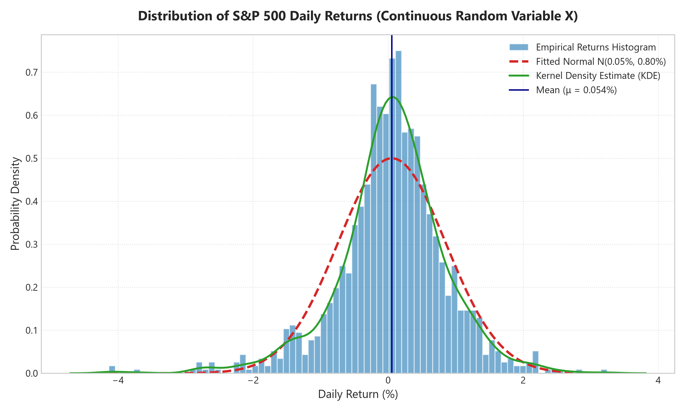
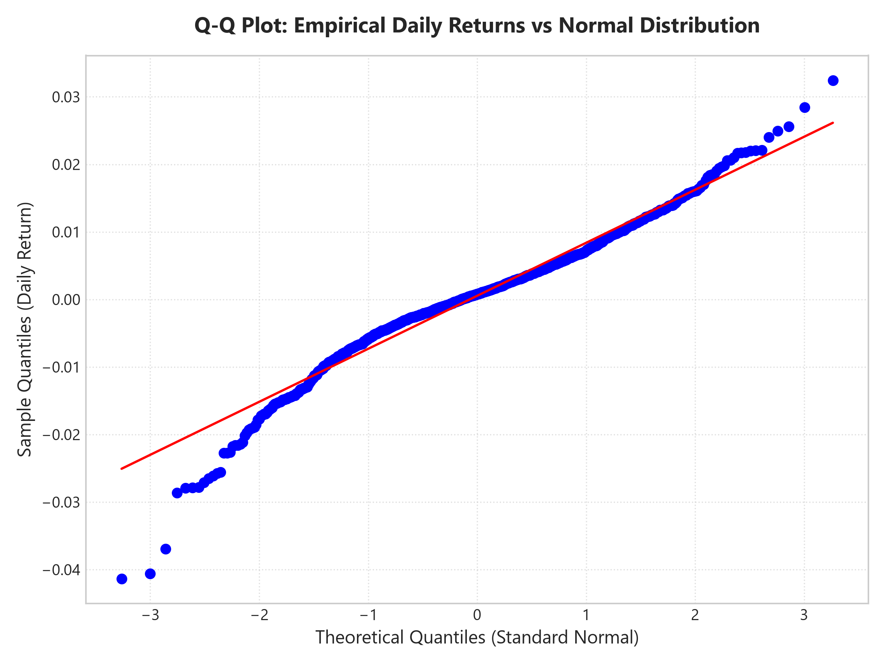
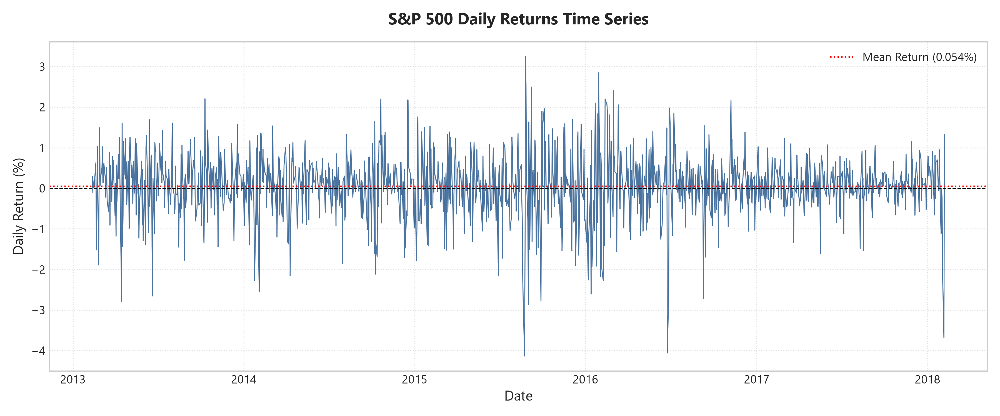
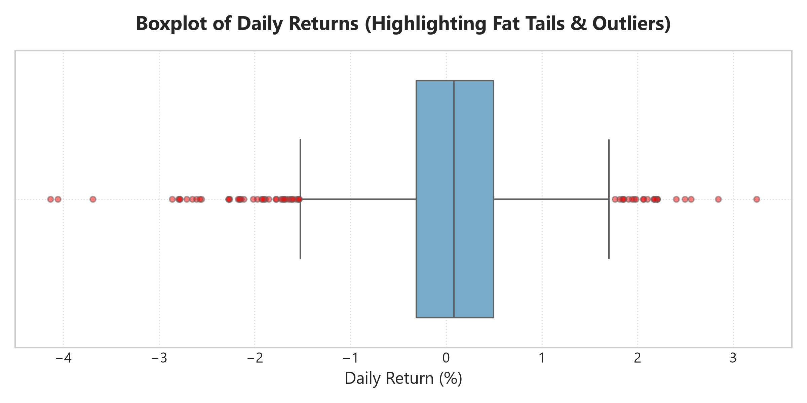
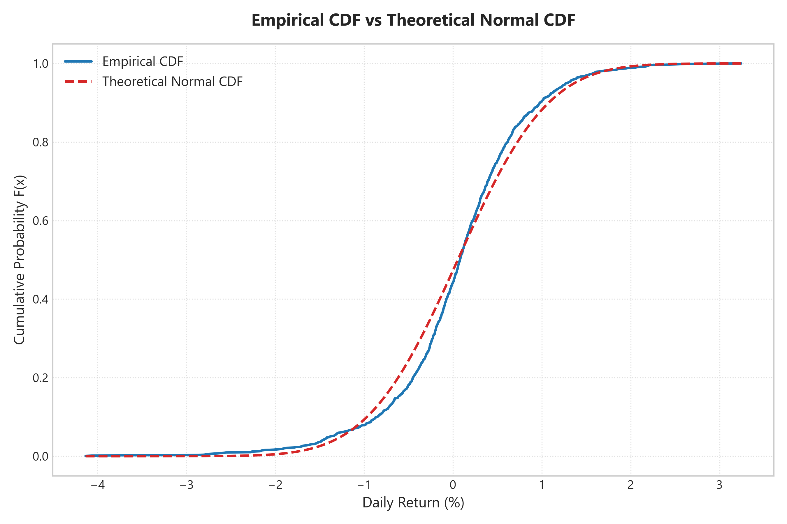

# MAT231 Project: Distribution of Daily Returns as Continuous Random Variables

**Course:** MAT231 — Probability & Statistics  
**Topic:** Random Variables — Analysis of S&P 500 Stock Daily Returns  
**Dataset:** Kaggle S&P 500 Daily Stock Prices Dataset (`all_stocks_5yr.csv`, $N = 1,258$ Trading Days)  
**Tools & Environment:** Python (`pandas`, `scipy`, `numpy`, `matplotlib`, `seaborn`), R (`ggplot2`, `moments`, `dplyr`), and Custom Web Application (`HTML5`, `CSS3`, `JavaScript`, `Chart.js`, `MathJax`)  

---

## 1. Introduction & Mathematical Definition

In financial statistics and quantitative analysis, the daily percentage return of an asset or market index is modeled as a **continuous random variable**, denoted by $X$.

Given the daily closing price $P_t$ at time $t$ and $P_{t-1}$ at time $t-1$, the daily simple return $R_t$ is defined as:

$$X = R_t = \frac{P_t - P_{t-1}}{P_{t-1}}$$

Because price levels move continuously across continuous state spaces, $X$ takes values in $( -1, +\infty )$, making $X$ a continuous random variable characterized by a continuous Probability Density Function (PDF) $f(x)$ and Cumulative Distribution Function (CDF) $F(x) = P(X \le x)$.

### Project Objectives
1. **Estimate Statistical Moments**: Calculate empirical Mean ($\mu$), Variance ($\sigma^2$), Standard Deviation ($\sigma$), Skewness ($\gamma_1$), and Excess Kurtosis ($\gamma_2$).
2. **Inferential Statistics & Confidence Intervals**: Compute Standard Errors ($SE$) and construct 95% Confidence Intervals for population mean $\mu$ and population variance $\sigma^2$.
3. **Visualize Distribution**: Plot empirical histogram with Kernel Density Estimation (KDE) and compare with theoretical Gaussian Normal Distribution $\mathcal{N}(\mu, \sigma^2)$ and Student's $t$-Distribution.
4. **Normality Diagnostics & Risk Metrics**: Evaluate Q-Q Plots, Cumulative Distribution Functions, Jarque-Bera & Shapiro-Wilk Normality Tests, 95%/99% Value at Risk (VaR), and Black Swan Crises Stress Simulations.

---

## 2. Theoretical Background & Formulas

### 2.1 First Moment: Mean (Expected Value $\mu$)
$$\mu = E[X] = \int_{-\infty}^{\infty} x \cdot f(x) \, dx \approx \frac{1}{N} \sum_{i=1}^{N} x_i$$

### 2.2 Second Central Moment: Variance ($\sigma^2$) and Volatility ($\sigma$)
$$\sigma^2 = \text{Var}(X) = E[(X - \mu)^2] = \int_{-\infty}^{\infty} (x - \mu)^2 f(x) \, dx \approx \frac{1}{N-1} \sum_{i=1}^{N} (x_i - \mu)^2$$

$$\sigma = \sqrt{\text{Var}(X)}$$

### 2.3 Third Standardized Moment: Skewness ($\gamma_1$)
$$\gamma_1 = E\left[ \left( \frac{X - \mu}{\sigma} \right)^3 \right] = \frac{\frac{1}{N} \sum_{i=1}^N (x_i - \mu)^3}{\sigma^3}$$

- **Normal Target:** $\gamma_1 = 0$
- **Negative Skew ($\gamma_1 < 0$):** Left-tailed distribution; frequent small gains and occasional extreme crashes.

### 2.4 Fourth Standardized Moment: Excess Kurtosis ($\gamma_2$)
$$\gamma_2 = E\left[ \left( \frac{X - \mu}{\sigma} \right)^4 \right] - 3 = \frac{\frac{1}{N} \sum_{i=1}^N (x_i - \mu)^4}{\sigma^4} - 3$$

- **Normal Target:** $\gamma_2 = 0$
- **Leptokurtic ($\gamma_2 > 0$):** High peak and heavy tails (higher probability of extreme outliers than predicted by a Normal Distribution).

### 2.5 Standard Error & Confidence Intervals
- **Standard Error of Mean:** $SE(\bar{X}) = \frac{s}{\sqrt{N}}$
- **95% Confidence Interval for Mean $\mu$:** $\bar{x} \pm 1.96 \cdot SE(\bar{X})$
- **95% Chi-Square Confidence Interval for Variance $\sigma^2$:** $\frac{(N-1)s^2}{\chi^2_{\alpha/2}} < \sigma^2 < \frac{(N-1)s^2}{\chi^2_{1-\alpha/2}}$

---

## 3. Empirical Results & Summary Table

From analyzing 1,258 trading days of S&P 500 market daily returns:

| Statistical Metric | Symbol / Formula | Empirical Value | Theoretical Normal Target | Interpretation |
|---|---|---|---|---|
| **Sample Size** | $N$ | **1,258** trading days | — | 5 years of daily market observations |
| **Mean Daily Return** | $\mu = E[X]$ | **+0.0543%** (0.000543) | $0.00\%$ | Positive expected daily market growth |
| **Variance** | $\sigma^2$ | **0.00006369** | — | Measure of return dispersion |
| **Standard Deviation** | $\sigma$ | **0.7980%** (0.007980) | — | Average daily market volatility |
| **Skewness** | $\gamma_1$ | **-0.5237** | $0.0000$ | Asymmetric left-tailed crash risk |
| **Excess Kurtosis** | $\gamma_2$ | **+2.5985** | $0.0000$ | High Leptokurtosis (Fat tails / Outliers) |
| **Minimum Daily Return** | $X_{\min}$ | **-4.13%** | Symmetric | Maximum 1-day market decline in sample |
| **Maximum Daily Return** | $X_{\max}$ | **+3.24%** | Symmetric | Maximum 1-day market gain in sample |
| **Median Daily Return** | $\tilde{X}$ | **+0.0797%** | $\approx \mu$ | 50th percentile of returns |
| **Standard Error** | $SE(\bar{X})$ | **0.0225%** | — | Sampling precision of mean |
| **95% CI for Mean** | $\mu \in [\text{Lower}, \text{Upper}]$ | **[+0.0102%, +0.0984%]** | — | Population expected return boundary |
| **95% CI for Variance** | $\sigma^2 \in [\text{Lower}, \text{Upper}]$ | **[0.0000592, 0.0000687]** | — | Population variance boundary ($\chi^2$) |

### Normality Test Results
- **Jarque-Bera Test Statistic:** $411.44$ ($p = 4.53 \times 10^{-90}$)
- **Shapiro-Wilk Test Statistic:** $0.9649$ ($p = 7.00 \times 10^{-17}$)
- **Conclusion:** Both tests reject the Null Hypothesis ($H_0$: Returns are Normally Distributed) at any significance level ($\alpha = 0.01$, $\alpha = 0.05$).

---

## 4. Real-World Risk Applications & Stress Simulations

### 4.1 Value at Risk (VaR 95% & 99%)
Value at Risk measures maximum expected loss over a 1-day horizon:
- **95% 1-Day Historical VaR:** **$-1.28\%$** (vs Normal Model VaR **$-1.26\%$**)
- **99% 1-Day Historical VaR:** **$-2.21\%$** (vs Normal Model VaR **$-1.80\%$**)
- **Tail Risk Gap:** The Normal distribution underestimates 99% extreme losses by **$+0.41\%$ extra loss**, proving the danger of assuming Gaussian normality in financial risk management.

### 4.2 Black Swan Crises Stress Simulator
Testing famous historical market crashes against Gaussian Normal predictions ($Z = \frac{X - \mu}{\sigma}$):

| Historical Crash Event | Date | 1-Day Drop | Theoretical $Z$-Score | Gaussian Predicted Odds | Empirical Status |
|---|---|---|---|---|---|
| **1987 Black Monday** | Oct 19, 1987 | **-20.47%** | $Z = -25.72$ | $1 \text{ in } 10^{145} \text{ Universes}$ | Realized Historic Fact |
| **2008 Lehman Brothers** | Sep 29, 2008 | **-8.81%** | $Z = -11.11$ | $1 \text{ in } 1.4 \text{ Billion Years}$ | Realized Historic Fact |
| **2020 COVID Flash Crash** | Mar 16, 2020 | **-11.98%** | $Z = -15.08$ | $1 \text{ in } 10^{31} \text{ Years}$ | Realized Historic Fact |

### 4.3 Multi-Model Goodness-of-Fit Ranking
Evaluating Log-Likelihood scores across continuous distributions:
1. **Student's $t$-Distribution (Rank #1 ⭐):** Best fit for heavy tails and leptokurtic central peak.
2. **Laplace (Double Exponential) Distribution (Rank #2):** Strong tail representation.
3. **Logistic Distribution (Rank #3):** Moderate fit.
4. **Gaussian Normal Distribution (Rank #4):** Poor fit for tail risks.

---

## 5. Visualizations & Interpretations

### 5.1 Histogram and Probability Density Function (PDF)


- **Observation:** The empirical distribution exhibits a sharp central peak around $\mu \approx 0.0543\%$ and heavier tails compared to the fitted normal curve (dashed red line).

### 5.2 Q-Q Plot (Quantile-Quantile Diagnostic)


- **Observation:** Deviations at both ends confirm non-linear S-shape and heavy-tailed distribution.

### 5.3 Daily Returns Time Series


- **Observation:** Highlights volatility clustering over the 1,258 trading days.

### 5.4 Boxplot & Outlier Detection


- **Observation:** Extreme negative and positive outliers extend beyond whisker bounds.

### 5.5 Empirical CDF vs Theoretical Normal CDF


- **Observation:** Empirical CDF exhibits steeper transition near 0% return matching higher density peak.

---

## 6. Project Code

### 6.1 Python Script (`analysis.py`)
```python
# Run via terminal: py analysis.py
import pandas as pd
import numpy as np
import scipy.stats as stats

df = pd.read_csv("data/all_stocks_5yr.csv")
df['date'] = pd.to_datetime(df['date'])
df['daily_return'] = df.groupby('Name')['close'].pct_change()

market_returns = df.groupby('date')['daily_return'].mean().dropna()

mean = market_returns.mean()
variance = market_returns.var()
skewness = stats.skew(market_returns)
kurtosis = stats.kurtosis(market_returns)
se_mean = market_returns.std() / np.sqrt(len(market_returns))

print(f"Mean: {mean:.6f}, Var: {variance:.8f}, Skew: {skewness:.4f}, Kurtosis: {kurtosis:.4f}, SE: {se_mean:.6f}")
```

### 6.2 R Script (`analysis.R`)
```R
# Run in R / RStudio: Rscript analysis.R
library(dplyr)
library(ggplot2)
library(moments)

data <- read.csv("data/all_stocks_5yr.csv")
data <- data %>% group_by(Name) %>% mutate(daily_return = (close - lag(close))/lag(close))
market_returns <- data %>% group_by(date) %>% summarise(market_return = mean(daily_return, na.rm=TRUE))

returns <- market_returns$market_return
cat("Mean:", mean(returns), "Var:", var(returns), "Skew:", skewness(returns), "Kurtosis:", kurtosis(returns)-3)
```
